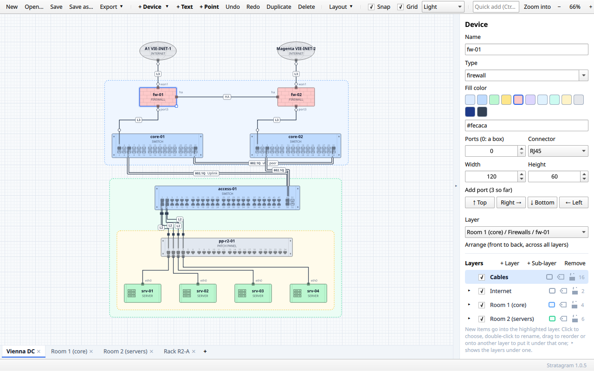
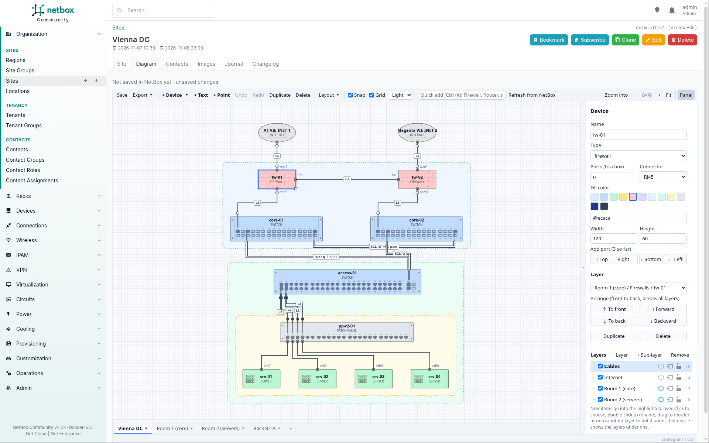

# Stratagram

A network diagram editor for getting a network onto the screen in minutes. Standardized stencils
and line types do the styling for you, so you think about the topology, and everyone on your team
reads the result the same way.

**[stratagram.app](https://stratagram.app)** · **[Try it in the browser](https://stratagram.app/editor/)** · **[Documentation](https://github.com/shinsterneck/stratagram/wiki)**

- Device types with their own shapes, and line types that say what a line carries (802.1Q, L2, L3,
  IPsec, VXLAN, MPLS and more)
- Quick add and auto layout: type what you need, Stratagram places and connects it
- Front panels with numbered ports, and cabling followed end to end through patch panels
- Layers, sheets, frames with title blocks, light, dark and neon themes
- Export to SVG, PNG, draw.io and Cisco Modeling Labs; plain JSON files

It runs as a desktop app on Linux and Windows, in the browser, and inside NetBox as a plugin that
draws every site from NetBox's data.

## Get it

- **Windows:** the installer from the [latest release](https://github.com/shinsterneck/stratagram/releases/latest)
- **Arch Linux:** `yay -S stratagram-bin` (or `stratagram` to build from source)
- **Other Linux:** the Linux download from the [latest release](https://github.com/shinsterneck/stratagram/releases/latest), or build from source
- **Browser:** <https://stratagram.app/editor/>, installable as an app that works offline
- **NetBox 4.5 to 4.7:** `pip install netbox-stratagram`

The [wiki](https://github.com/shinsterneck/stratagram/wiki) covers
[installation](https://github.com/shinsterneck/stratagram/wiki/Installation),
[building from source](https://github.com/shinsterneck/stratagram/wiki/Building-from-source),
how to use the editor, the file format and the command line.

## License

Copyright 2026 Shin Sterneck. Licensed under the [Apache License, Version 2.0](LICENSE): use, change
and share it freely, also commercially. Copies and builds you pass on, changed or not, keep the
license and the [NOTICE](NOTICE) file, which credits the original work.

Stratagram is built with open-source libraries under their own licenses (MIT, Apache-2.0, Zlib,
Unicode and others): `cargo about generate -c about.toml about.hbs` lists them with their license
texts, and the release downloads carry that list as `THIRD-PARTY-LICENSES.txt`. The desktop app uses
Qt, under the GNU LGPL v3, linked dynamically.

### Trademarks

Product and company names such as Cisco, NetBox, Amazon Web Services (AWS), Microsoft Azure, Google
Cloud, Alibaba Cloud, Deutsche Telekom (Telekom Cloud), STACKIT, Zscaler and draw.io are trademarks
of their respective owners. Stratagram uses them only to name the products and services a diagram
shows. The cloud provider tiles are simple stand-ins (a letter or short name in the provider's
color), not the providers' logos, and the router symbol is Stratagram's own drawing in the style of
common network diagram symbols. Stratagram is not affiliated with or endorsed by any of them.
