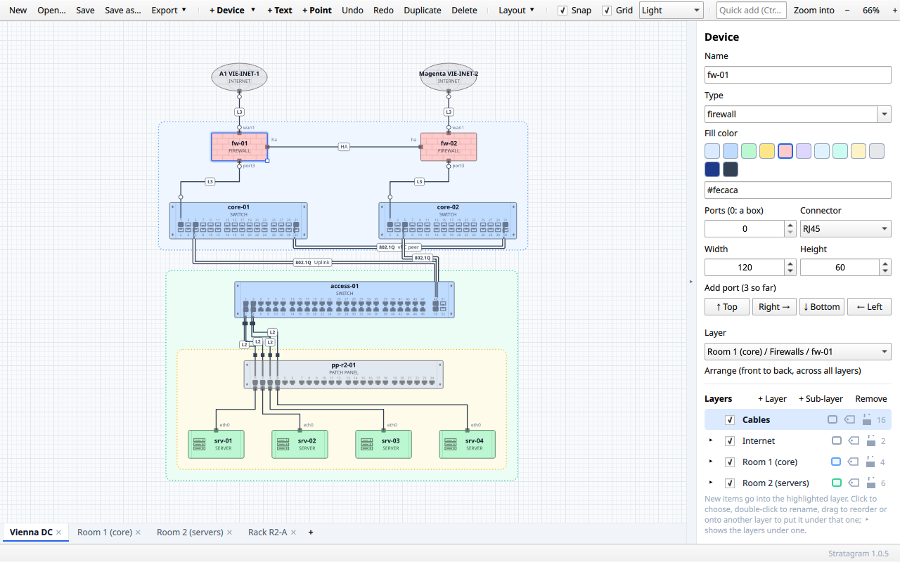
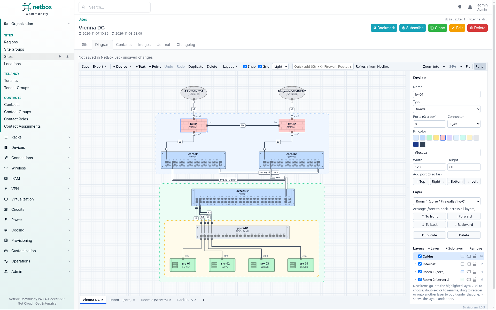

# Stratagram

[English](README.md) · 简体中文

Stratagram 是一款网络图编辑器，用几分钟就能画出网络拓扑。内置的设备图形和链路线型各有固定含义，绘图时可以专注于设备之间的连接，团队成员也能按同一套约定读图。

**[项目官网](https://stratagram.app)** · **[在浏览器中试用](https://stratagram.app/editor/)** · **[使用文档](https://github.com/shinsterneck/stratagram/wiki)**

- 通过图形区分设备类型，通过线型识别 802.1Q、L2、L3、IPsec、VXLAN、MPLS 等链路类型。
- 批量输入设备，将它们添加到画布上。拖动端口建立链路后，可用自动布局整理拓扑。
- 在设备前面板上查看带编号的端口，端到端追踪经过配线架的线缆。
- 使用图层和工作表组织拓扑，添加带标题栏的图框，在浅色、深色和霓虹主题之间切换。
- 以纯 JSON 文件保存网络图，也可导出 SVG、PNG、draw.io 或 Cisco Modeling Labs（CML）实验拓扑。

Stratagram 可在 Linux、Windows 或浏览器中运行，也可作为 NetBox 插件，根据站点数据生成网络图。编辑器支持英语和简体中文。在 Web 工具栏或桌面状态栏中选择语言，下次打开时会沿用该选择。

Web 编辑器、NetBox 插件和桌面编辑器共用 `web/www/locales/` 下的界面词库。界面代码使用 `file.save` 等稳定键。修改文案时，编辑 `en.mjs` 和 `zh-CN.mjs` 中的对应条目，两种语言都要保留 `{name}` 等具名占位符。运行 `node --test web/tests/locales.test.mjs` 可检查词库。

`core-messages.mjs` 将 Rust 控制器返回的消息映射到翻译键。Rust 生成的图中文字、新建文档的默认值以及命令行诊断信息使用 `core/locales/` 下的词库。导出时采用编辑器的当前语言。命令行依次读取 `LC_ALL`、`LC_MESSAGES`、`LANG`，均未设置时采用系统区域设置。切换语言会保留网络图中已有的名称和文本。

## 安装与使用

- **Windows** 可从[最新发布页](https://github.com/shinsterneck/stratagram/releases/latest)下载安装程序。
- **Arch Linux** 可运行 `yay -S stratagram-bin` 安装预编译包，也可安装 `stratagram` 从源码构建。
- **其他 Linux 发行版** 可从[最新发布页](https://github.com/shinsterneck/stratagram/releases/latest)下载 Linux 版本，也可从源码构建。
- **浏览器** 可直接[打开编辑器](https://stratagram.app/editor/)，也可将其安装为支持离线使用的应用。
- **NetBox 4.5 至 4.7** 可运行 `pip install netbox-stratagram` 安装插件。

项目 Wiki 提供安装与构建指南，并介绍编辑器的使用方法、文件格式和命令行用法。[安装指南](https://github.com/shinsterneck/stratagram/wiki/Installation) · [从源码构建](https://github.com/shinsterneck/stratagram/wiki/Building-from-source) · [Wiki 首页](https://github.com/shinsterneck/stratagram/wiki)

## 许可证

版权所有 © 2026 Shin Sterneck。Stratagram 采用 Apache License 2.0，允许使用、修改和分发，包括商业用途。分发原版或修改版的副本及构建产物时，请保留许可证和注明原作归属的 NOTICE 文件。[LICENSE](LICENSE) · [NOTICE](NOTICE)

Stratagram 使用的开源库各自遵循 MIT、Apache-2.0、Zlib、Unicode 等许可证。运行 `cargo about generate -c about.toml about.hbs` 可列出这些库及其许可证全文。发布包中的 `THIRD-PARTY-LICENSES.txt` 包含这份清单。桌面应用动态链接 Qt，使用 Qt 的 GNU LGPL v3 授权。

### 商标

Cisco、NetBox、Amazon Web Services（AWS）、Microsoft Azure、Google Cloud、Alibaba Cloud、Deutsche Telekom（Telekom Cloud）、STACKIT、Zscaler 和 draw.io 等名称均为各自权利人的商标。Stratagram 使用这些名称来标识网络图中的产品和服务。云服务商图标采用服务商的配色和字母或简称，路由器符号由 Stratagram 参照常见网络图符号自行绘制。Stratagram 与上述商标权利人没有隶属关系，也未获得其背书。
